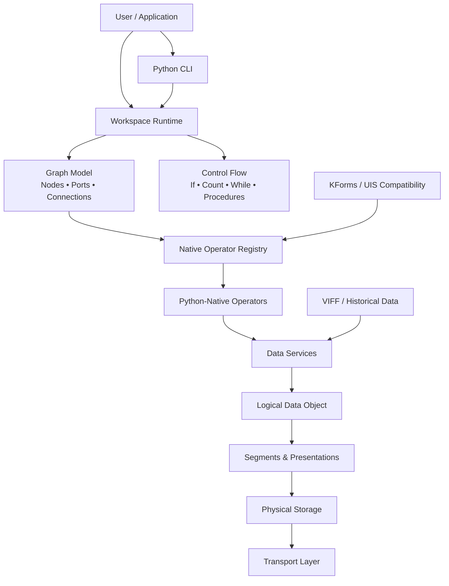

# Khoros / Cantata — Python-Native Reconstruction

> A source-driven Python reconstruction of the Khoros/Cantata data-flow programming environment, its workspace model, data services, UIS/KForms semantics, historical data formats, and selected scientific operators.

[](#installation)
[](#validation)
[](#project-status)

## Why this project matters

Khoros was an important scientific-computing environment that brought image processing, signal processing, data manipulation, visualization, and visual programming together. Cantata provided the visual data-flow layer: users connected processing operators into executable graphs called workspaces.

The original system is historical software. Its source is difficult to build on modern systems, some original runtime components are unavailable, and the original executable is not available here as a universal behavioral oracle.

This project asks a practical question:

**Can the important ideas and useful behavior of Khoros/Cantata be reconstructed in a modern, understandable, Python-native form without making the old executable part of the runtime?**

The answer reached by this project is **yes for the documented supported scope**, with explicit limitations where historical evidence is incomplete.

---

## What is included

- **Workspace/data-flow runtime** — nodes, ports, connections, fan-out, nested procedures, loops, and conditional execution.
- **Historical workspace restoration** — parsing and executing recovered `.wksp` structures.
- **KForms / UIS compatibility** — parsing historical pane definitions and exposing operator properties.
- **Data Services model** — logical data objects, physical storage, segments, presentations, and transport concepts.
- **VIFF support** — historical Khoros image/data representation support.
- **KDBM/CMS compatibility** — Python-side handling of recovered configuration/database structures.
- **Numerical compatibility work** — FFT, sinusoid generation, convolution, clipping, arithmetic, and related validation infrastructure.
- **Native operator registry** — Python operators can replace legacy executable calls at the workspace boundary.
- **Documentation** — separate user and programmer documentation written for readers who may not know Khoros or its original C architecture.
- **Regression tests** — release tests plus historical evidence and validation artifacts.

## Architecture at a glance



### The central design idea

The reconstruction keeps three things separate:

1. **What the workflow means** — the graph of operators and connections.
2. **What the data means** — logical objects, dimensions, types, segments, and presentations.
3. **How data moves** — files, memory, streams, sockets, or another transport.

That separation is important because the original Khoros system could change its physical transport without changing the logical workflow.

---

## The Cantata execution model

A historical workspace can be viewed as a directed graph:

```text
                 ┌─────────────┐
                 │ Input Data  │
                 └──────┬──────┘
                        │
                        ▼
                 ┌─────────────┐
                 │   Operator  │
                 │     A       │
                 └──────┬──────┘
                        │
             ┌──────────┴──────────┐
             ▼                     ▼
      ┌─────────────┐       ┌─────────────┐
      │  Operator B │       │  Operator C │
      └──────┬──────┘       └──────┬──────┘
             │                     │
             └──────────┬──────────┘
                        ▼
                 ┌─────────────┐
                 │    Output   │
                 └─────────────┘
```

In the original system, a connection could correspond to a temporary file or another transport object. The Python runtime preserves the **connection identity and data-flow meaning** rather than forcing every connection to become a disk file.

### Workspace nesting

Cantata workspaces can contain procedures and loops. The reconstructed runtime represents this hierarchy directly:

```text
Workspace
├── Input
├── Procedure: preprocess
│   ├── Operator
│   ├── Operator
│   └── Output
├── Count Loop
│   └── Operator chain
├── Conditional
│   ├── true branch
│   └── false branch
└── Output
```

---

## Project history

The reconstruction was performed as a sequence of controlled phases rather than as a direct rewrite of old C code.

| Phase | Focus | Status |
|---|---|---|
| 0 | Source inventory and baseline | Complete |
| 1 | Kernel architecture and source reconstruction | Complete |
| 2 | Canonical Python specification | Complete |
| 3 | Python kernel prototype | Complete |
| 4 | Workspace persistence | Complete |
| 5 | Expression/control compatibility | Complete |
| 6 | Legacy execution boundary | Complete |
| 7 | Core data services | Complete |
| 8 | Operator migration | Complete |
| 9 | Validation/regression foundation | Complete |
| 10 | Python-native UI/property layer | Complete |
| 11 | Release candidate | Complete |
| 12–15 | Closure, audit, evidence factory | Complete |
| 16 | Differential conversion factory | Complete with explicit oracle limitation |
| 17 | Fortran numerical reimplementation | Complete |
| 18 | Exact data/binary/database work | Complete |
| 19 | KForms/UIS compatibility | Complete |
| 20 | Workspace execution closure | Complete with external-data limitation |
| 21 | Image/signal end-to-end validation | Complete with historical-oracle limitation |
| 22 | Legacy independence and release validation | Complete |

The project deliberately records evidence strength instead of treating every implemented function as historically proven.

---

## Validation

The final validation package contains several different kinds of evidence.

### Release validation

**6/6 clean-release tests passed.**

These tests exercise the public Python package without requiring the historical Khoros executable.

### End-to-end numerical validation

Phase 21 established **11/11 focused native checks passing**, including image/data and signal-processing paths.

The recovered historical corpus also contains:

- 39 historical DATAMANIP test suites
- 67 historical test scripts
- 227 historical golden-result artifacts
- 37 historical test-data files

### Workspace validation

The recovered workspace corpus contains:

- 5 historical workspace files
- 57 glyph records
- 45 connections

Phase 20 validated historical workspace restoration, fan-out connections, nested procedures, count loops, conditionals, and Python-native execution for representative workflows.

### Operator closure

The final closure matrix contains **134 operator records**.

The project does **not** claim that all 134 are bit-for-bit equivalent to the unavailable historical executable. The closure matrix distinguishes implementation status from behavioral evidence.

See [`reports/final_134_operator_closure_matrix.csv`](reports/final_134_operator_closure_matrix.csv).

---

## Explicit use cases

### Use case 1 — Inspect an old Cantata workspace

Use the workspace parser to load a recovered `.wksp` file and inspect its operators, connections, variables, and control structures.

```python
from khoros_cantata.workspace_runtime import HistoricalWorkspaceParser

workspace = HistoricalWorkspaceParser().parse("example.wksp")

print(workspace.name)
for glyph in workspace.glyphs:
    print(glyph.toolbox, glyph.object_name)
```

This is useful when the goal is to understand an old workflow before attempting to run it.

### Use case 2 — Run a Python-native workflow

Register or select native Python operators and execute a workspace without launching the historical Khoros programs.

```python
from khoros_cantata.workspace_runtime import WorkspaceExecutor

executor = WorkspaceExecutor()
result = executor.run(workspace)
print(result)
```

### Use case 3 — Validate numerical behavior

Use the Phase 21 numerical compatibility functions to test operations such as FFT, convolution, clipping, and signal generation.

```python
from khoros_cantata.phase21_numeric import fft_compatible

output = fft_compatible(signal, direction="forward")
```

### Use case 4 — Work with historical VIFF data

Use the VIFF compatibility module to inspect or convert supported historical data.

```python
from khoros_cantata import viff

image = viff.read("image.viff")
print(image.shape)
```

### Use case 5 — Develop a new native operator

A developer can implement a Python function, register it with the operator registry, and connect it to a workspace rather than writing a new C executable.

This is the basic modernization path: **preserve the workflow contract while replacing the old process implementation.**

---

## Installation

Python 3.11 or newer is required.

```bash
python -m venv .venv
```

Activate the environment and install the project:

```bash
# Windows PowerShell
.venv\\Scripts\\Activate.ps1

# Linux/macOS
source .venv/bin/activate

python -m pip install -e .
```

Run the release tests:

```bash
python -m pytest
```

---

## Repository layout

```text
khoros_github/
├── khoros_cantata/              # Python implementation
│   ├── kernel.py                # core graph/runtime concepts
│   ├── workspace_runtime.py     # historical workspace execution
│   ├── kforms_compat.py         # UIS/KForms compatibility
│   ├── operator_spec.py         # operator definitions
│   ├── property_panel.py        # native property model
│   ├── kdms_object.py           # Data Services object model
│   ├── viff.py                  # VIFF support
│   ├── kdbm_compat.py           # KDBM compatibility
│   ├── cms.py                   # configuration metadata
│   ├── kbit.py                  # bit-level helpers
│   └── phase21_numeric.py       # numerical compatibility
│
├── tests/                       # release tests
├── docs/                        # user and programmer documentation
├── reports/                     # validation and closure reports
├── audit/                       # legacy dependency audit
└── validation/                  # historical-corpus guidance
```

---

## Documentation

### For users

Start with [`docs/USER_MANUAL.html`](docs/USER_MANUAL.html).

It explains the system without assuming knowledge of the original Khoros implementation and includes practical examples.

### For programmers

Start with [`docs/PROGRAMMER_GUIDE.html`](docs/PROGRAMMER_GUIDE.html).

Then see:

- [`docs/API_REFERENCE.md`](docs/API_REFERENCE.md)
- [`docs/CODE_DOCUMENTATION.md`](docs/CODE_DOCUMENTATION.md)
- [`docs/DEVELOPER_CHECKLIST.md`](docs/DEVELOPER_CHECKLIST.md)
- [`docs/COMPATIBILITY_AND_LIMITATIONS.html`](docs/COMPATIBILITY_AND_LIMITATIONS.html)

---

## Historical source and licensing note

This repository is a **Python reconstruction**, not a redistribution of the original Khoros source tree.

The recovered historical source corpus and private validation datasets are not included. Public release tests run without that corpus.

See [`LICENSE`](LICENSE) for the license covering this project and [`LICENSE_NOTICE.txt`](LICENSE_NOTICE.txt) for licensing and historical-provenance details.

---

## What this project is not

- It is not a claim that every original Khoros operator has been reproduced bit-for-bit.
- It is not a replacement for every proprietary or site-specific Khoros extension.
- It does not require the original Khoros executable for its native runtime.
- It does not silently treat missing historical evidence as proof of equivalence.

The project favors **traceable evidence over optimistic compatibility claims**.

---

## Project status

**Phase 22 — Final Legacy Independence and Release Validation: complete.**

The planned Phase 0–22 reconstruction program is complete. Further work is best treated as a new validation or product-development effort, such as broader real-world workflow testing, additional operator validation, performance work, or development of a modern graphical workspace editor.

---

## Contributing

See [`CONTRIBUTING.md`](CONTRIBUTING.md).

The most useful contributions are:

- historical test data with clear provenance
- historical workspace examples
- independent numerical comparisons
- additional native operator implementations
- documentation improvements
- clean-install and platform testing

When adding compatibility behavior, document the evidence behind it.

---

## License and provenance

This project is licensed under the Apache License, Version 2.0; see [`LICENSE`](LICENSE). The license applies to project materials included in this repository, not to external historical Khoros materials that are not included here.

---

## A note about the original system

Khoros and Cantata are historical names and technologies. This project is an independent reconstruction and is not presented as an official product of the original Khoral Research organization.
