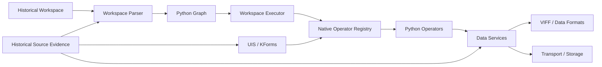

# Architecture Overview

## 1. The system in one picture



## 2. Historical boundary

The original Cantata system built process commands from operator forms and executed Khoros programs. The reconstruction moves that boundary inward:

```text
Historical Khoros

Cantata graph
     |
     v
command construction
     |
     v
legacy executable
     |
     v
data transport


Python-native reconstruction

Cantata graph
     |
     v
workspace runtime
     |
     v
operator registry
     |
     v
Python implementation
     |
     v
data services
```

The second path removes the historical executable from the production runtime.

## 3. Why the layers matter

### Workspace layer

Answers: **What should run, and in what relationship?**

It contains nodes, ports, connections, variables, procedures, loops, and conditionals.

### Operator layer

Answers: **What operation does this node perform?**

An operator may be a Python-native implementation or a compatibility adapter.

### Data layer

Answers: **What does the data mean?**

The original data model is richer than a single NumPy array. It includes logical objects, physical storage, segments, presentations, data types, dimensions, and attributes.

### Transport layer

Answers: **How does the data move?**

Historically this could involve files, shared memory, pipes, streams, sockets, and other mechanisms. The reconstruction keeps transport separate from logical data semantics.

## 4. Evidence levels

Compatibility claims should be classified as:

- **Source-derived** — behavior follows directly from recovered source code.
- **Corpus-derived** — behavior is demonstrated by historical examples or golden data.
- **Native validated** — the Python implementation passes a defined regression test.
- **Historically differential** — Python output was compared with a runnable original executable.

The last category is limited because the original executable is not available as a general oracle in this project.
